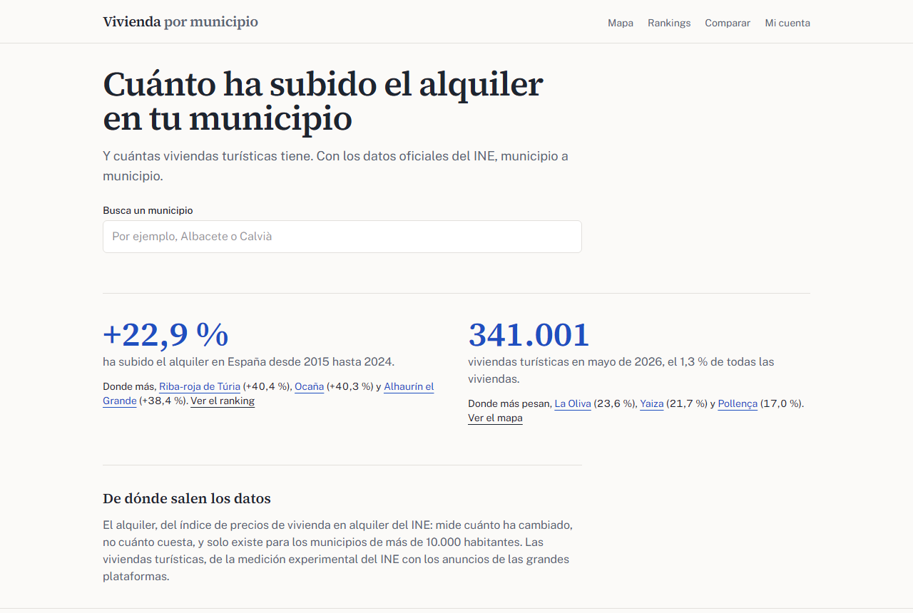
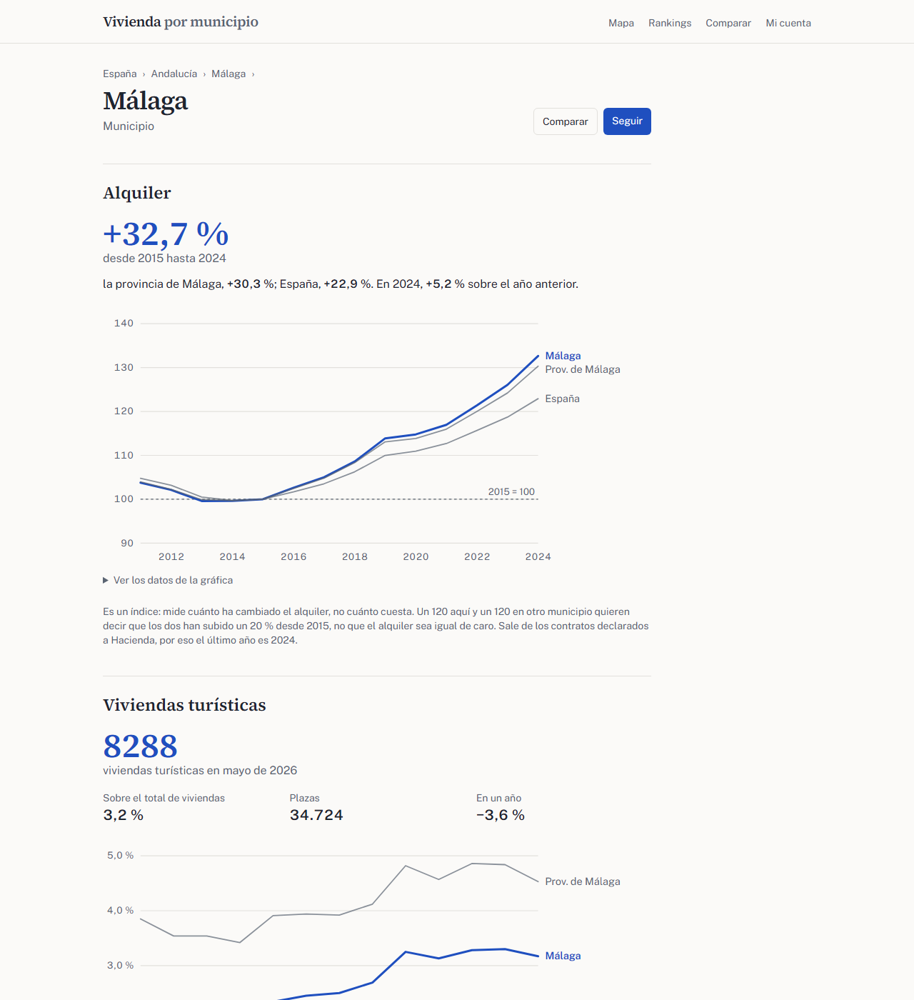
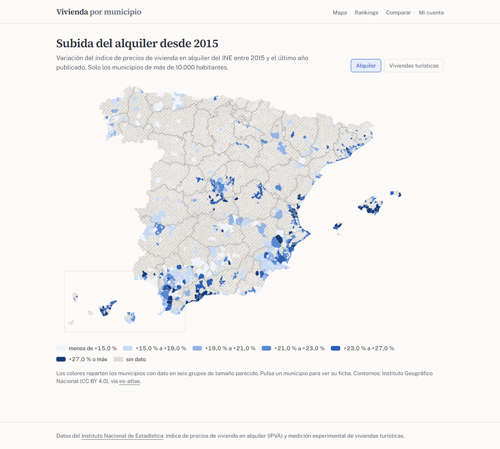
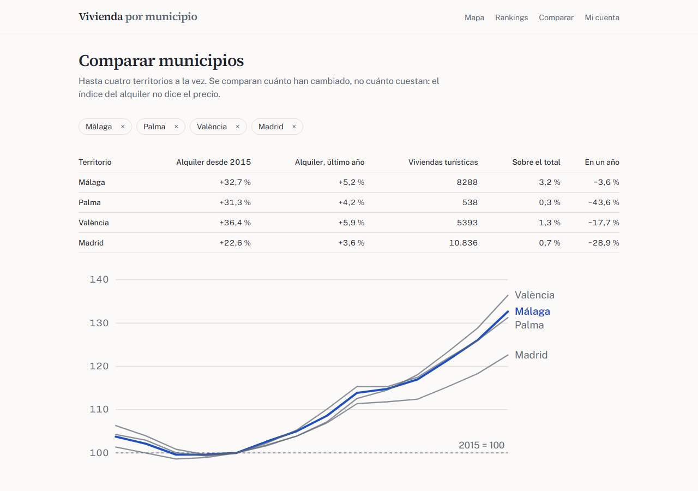
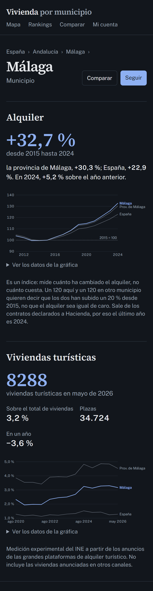

# Vivienda por municipio

Web para consultar, municipio a municipio, **cuánto ha subido el alquiler** desde 2015 y **cuántas viviendas
turísticas hay**, con los datos oficiales del INE. Ficha de cada municipio con su provincia y España como referencia,
mapa de España por municipio, rankings y comparador. Con una cuenta (enlace mágico por correo) se pueden seguir
municipios y guardar comparaciones.

**Next.js 16 (App Router, Server Components, Cache Components) · TypeScript · Supabase (Postgres, Auth, RLS) ·
Tailwind CSS 4 · d3-geo · zod · Vitest · pgTAP · Playwright + axe**

| Inicio | Ficha de un municipio | Mapa |
|---|---|---|
|  |  |  |

| Comparador | En el móvil, tema oscuro |
|---|---|
|  |  |

Las cifras de las capturas son las publicadas por el INE (IPVA 2024 y viviendas turísticas de mayo de 2026).

## Los datos

API JSON del INE (`servicios.ine.es/wstempus`), sin clave:

- **Índice de precios de vivienda en alquiler (IPVA)**, tablas 59056 (España y comunidades), 59058 (provincias) y
  59060 (municipios): anual desde 2011, base 2015 = 100, con la variación anual.
- **Medición experimental de viviendas turísticas (VTE)**, tablas 39363 y 39366: viviendas, plazas y porcentaje sobre
  el total de viviendas, por semestre.

Lo que la web cuenta al lado de cada cifra, porque cambia cómo se lee:

- El IPVA es un **índice**: dice cuánto ha cambiado el alquiler, no cuánto cuesta. Por eso la web compara **subidas**
  entre municipios y nunca índices como si fueran precios.
- Solo hay índice para los municipios de **más de 10.000 habitantes** (unos 720). El resto sale como «sin dato», con
  un rayado distinto del color de un valor bajo.
- Sale de los contratos declarados a Hacienda: el último año publicado es 2024.
- Las viviendas turísticas son una medición **experimental** a partir de los anuncios de las grandes plataformas.
- En el ranking de viviendas turísticas solo entran los municipios con al menos 100: con menos, el porcentaje de un
  pueblo pequeño se dispara con un par de anuncios.

## Qué hace

- **Buscador** sin tildes y tolerante a erratas (`unaccent` + trigramas en Postgres), que pone primero lo que empieza
  por lo escrito («coru» → A Coruña antes que Coruña del Conde). Combobox accesible con teclado.
- **Ficha** de municipio, provincia, comunidad o España: subida desde 2015, la de su provincia y la de España, la
  variación del último año y la gráfica; viviendas turísticas, plazas, porcentaje y variación frente al mismo mes del
  año anterior. Las gráficas son SVG dibujado en el servidor, con etiquetas directas y la tabla de datos al lado.
- **Mapa** de España por municipio para cada indicador, con Canarias en recuadro, colores por cuantiles (escala de un
  solo tono, legible con daltonismo) y cada municipio enlazado a su ficha.
- **Rankings** de los que más y menos han subido y **comparador** de hasta cuatro territorios con la URL como estado
  (`/comparar?t=m29067,m07040`): se puede compartir.
- **Cuenta** con enlace mágico: seguir municipios y guardar comparaciones con nombre. Sin contraseñas.

## Arquitectura

```
src/
├── app/                     Rutas (App Router)
│   ├── territorio/[slug]    Ficha: las de los municipios con índice se generan al construir; el resto, al pedirlas
│   ├── mapa/[indicador]     Mapa y leyenda; el SVG se sirve aparte desde mapa/[indicador]/svg
│   ├── ranking/[indicador]  Rankings
│   ├── comparar             Comparador (estado en la URL)
│   ├── cuenta               Entrar, municipios seguidos y comparaciones guardadas
│   ├── auth/confirmar       Canje del código del enlace mágico (PKCE)
│   ├── api/buscar           Búsqueda para el combobox
│   ├── api/revalidar        Renueva la caché al terminar una carga (con secreto)
│   └── acciones.ts          Server Actions: seguir, guardar y borrar comparaciones, entrar y salir (validadas con zod)
├── componentes/             Gráfica, mapa y buscador; solo son de cliente los que tienen interacción
├── lib/
│   ├── datos.ts             Lecturas de Supabase en caché ('use cache', etiqueta «ine», un día)
│   ├── calculos.ts          Subidas, variaciones y huecos de las series
│   ├── mapa.ts              TopoJSON de es-atlas → SVG (simplificación, proyección, Canarias, cuantiles)
│   ├── ine/transformar.ts   Respuestas del INE (validadas con zod) → filas
│   └── supabase/            Cliente público sin cookies (datos en caché) y cliente con sesión por petición
└── proxy.ts                 Refresca la sesión de Supabase en cada petición
scripts/cargar-ine.ts        Carga idempotente del INE con la clave de servicio
supabase/                    Migraciones, configuración local y pruebas pgTAP
```

- **Dos clientes de Supabase**. Los datos públicos se leen con un cliente sin cookies desde funciones con
  `'use cache'`: la respuesta es la misma para todos y se puede guardar. Lo del usuario se lee con un cliente creado
  en cada petición con sus cookies (`@supabase/ssr`), nunca uno global.
- **La seguridad está en la base, no en el código**: RLS en todas las tablas. Los datos del INE son de lectura para
  todos y nadie puede escribirlos con la clave pública (permisos revocados); `seguimiento` y `comparacion` solo dejan
  ver y tocar lo de `auth.uid()`. La clave de servicio solo la usa el script de carga.
- **Prerenderizado parcial**: el marco, la ficha y el mapa salen estáticos; el botón de seguir, que depende de la
  sesión, llega después por streaming. Ver [ADR 3](docs/decisiones/0003-cache-components-y-prerenderizado-parcial.md).

Decisiones: [Supabase y RLS](docs/decisiones/0001-supabase-y-rls.md) ·
[mapa en SVG desde el servidor](docs/decisiones/0002-mapa-svg-en-el-servidor.md) ·
[Cache Components y prerenderizado parcial](docs/decisiones/0003-cache-components-y-prerenderizado-parcial.md).

## Rendimiento

Lighthouse (móvil simulado, construcción de producción con los datos completos): 95–98 en rendimiento y 100 en
accesibilidad, buenas prácticas y SEO en el inicio, la ficha, los dos mapas, el ranking y el comparador.

## Puesta en marcha

Hace falta Node 24 y Docker (para Supabase local).

```bash
npm install
npx supabase start          # Postgres, Auth y el buzón de pruebas (Mailpit) en Docker; aplica las migraciones
npm run entorno             # escribe .env.local con las claves de Supabase local
npm run cargar              # descarga el INE y carga unas 125.000 filas (unos 20 s); se puede repetir
npm run dev                 # http://localhost:3000
```

El correo del enlace mágico llega a Mailpit: <http://127.0.0.1:54324>.

`npm run cargar:muestra` carga en su lugar las respuestas grabadas de `tests/datos-ine` (13 territorios), que son las
que usan la CI y las pruebas de extremo a extremo.

## Pruebas

| Orden | Qué prueba |
|---|---|
| `npm test` | Vitest: transformación de las respuestas del INE, cálculos, formato en español, cuantiles y orientación de los polígonos del mapa, gráfica y buscador (Testing Library) |
| `npm run test:db` | pgTAP: RLS (un usuario no ve ni toca lo de otro, el anónimo no escribe nada), restricciones y orden de la búsqueda |
| `npm run test:e2e` | Playwright contra la web construida y Supabase local con la muestra: buscar, ficha con las cifras exactas, mapa, ranking, comparador, entrar con el enlace mágico leído de Mailpit, seguir, guardar y borrar, aislamiento entre usuarios, redirecciones a otras webs bloqueadas y axe (WCAG 2.1 AA) en escritorio y móvil |

La CI (`.github/workflows/ci.yml`) levanta Supabase local en el runner y pasa todo lo anterior, además de comprobar que
los tipos generados de la base están al día.

## Capturas

`node scripts/capturas.ts http://localhost:3000` con la web en marcha y los datos completos.

## Licencia

Código bajo licencia MIT. Datos: Instituto Nacional de Estadística (INE), reutilización libre citando la fuente.
Contornos de los municipios: [es-atlas](https://github.com/martgnz/es-atlas), a partir de los datos del IGN (CC BY 4.0).
